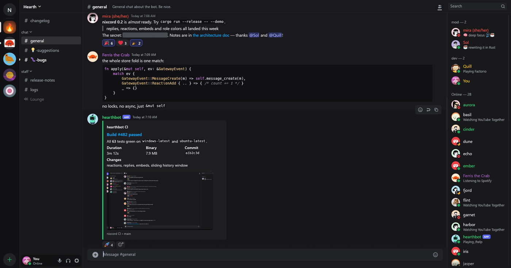
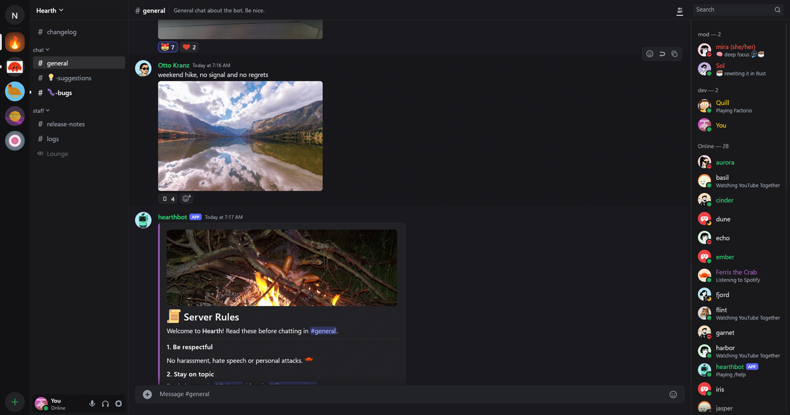
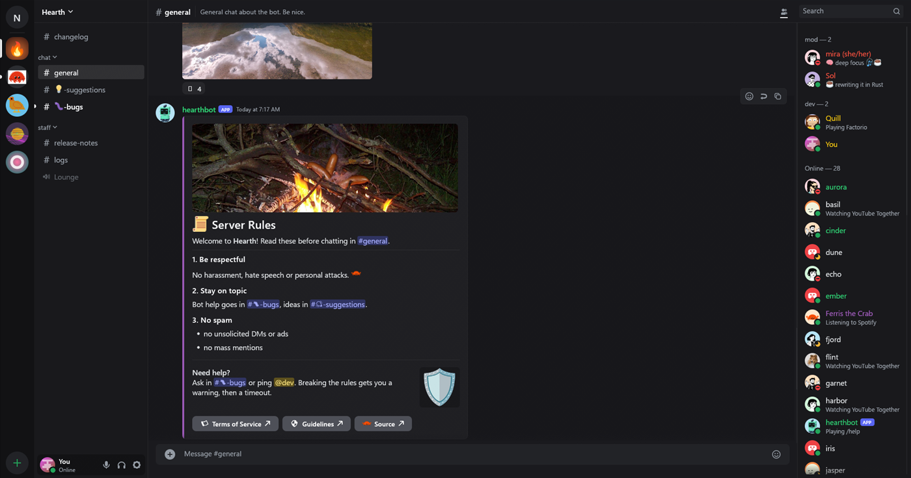
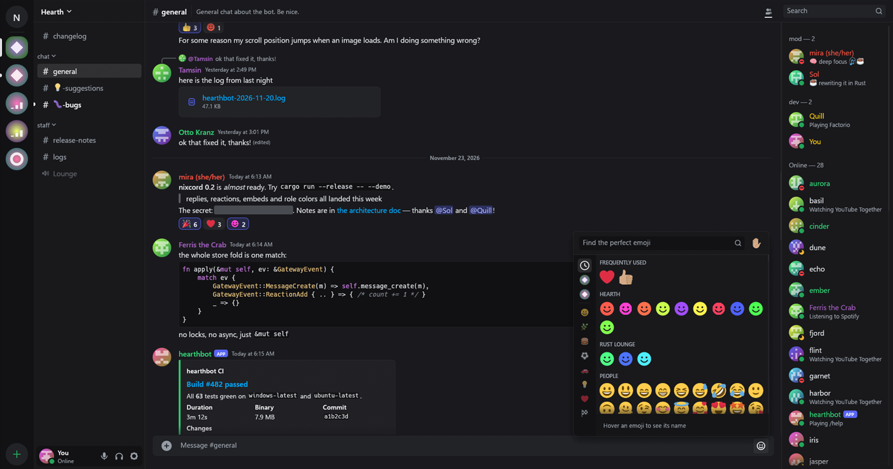
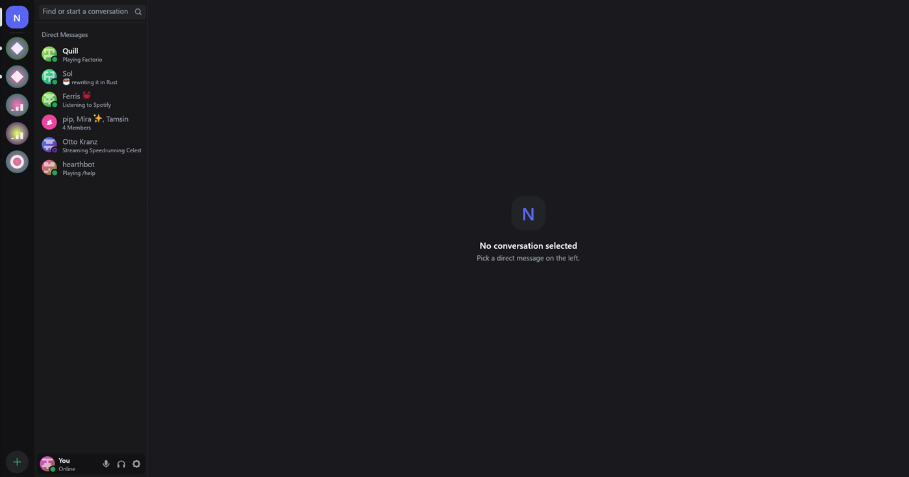

# nixcord

A lightweight, native Discord client written in Rust. No Electron, no webview, no telemetry.

- **Native UI** with [egui](https://github.com/emilk/egui): starts instantly, sips RAM.
- **Zero telemetry.** No analytics, no tracking, no crash reporting. See
  [Network](#network) for every host the client contacts.
- **Gradient themes**, a dozen built in, and easy to add your own.
- **Hackable.** A small crate-per-concern workspace with a pure, unit-tested state store.
  PRs welcome, forks welcome. It's open source, after all.



<details>
<summary>More screenshots</summary>

| | |
|---|---|
|  |  |
|  |  |

All screenshots are from `--demo` mode, using made-up servers, users and messages. Demo images
are CC0, public domain or Apache-2.0; see [assets/demo/LICENSES.md](assets/demo/LICENSES.md).
</details>

> [!WARNING]
> **Unofficial client. Use at your own risk.** Logging into Discord with a user token from a
> third-party client violates Discord's Terms of Service and can get your account
> suspended. nixcord is not affiliated with or endorsed by Discord Inc. It contains no
> self-bot, automation, spam, or scraping features, and contributions adding them will be
> rejected.

## Status

Early (v0.1). Working:

- Login, servers (with drag-and-drop reordering & custom server folders), channels, Forum channels, active threads (with creation, archiving & locking), DMs, Friends page, history, message search (`Ctrl+F`), and send (with file uploads, drag-and-drop & `Ctrl+V` clipboard image paste)/edit/delete/reply.
- Reactions, typing indicators, unread/mention badges, right-click "Mark as Read", in-app mention toasts, and `zlib-stream` reconnect/resume.
- Markdown with code highlighting, embeds, and interactive bot components (V2 layouts, clickable buttons, string selects, and searchable User/Role/Mentionable/Channel entity selects).
- Avatars and server icons, color emoji (Twemoji) with a picker and `:shortcode:`
  autocomplete, and custom emoji.
- An in-app image viewer, GIF/animated WebP playback, and inline H.264 video with audio.
- Presence, persistent status and custom status editor, floating user profile popouts, the member list with role groups, and permission-aware channel lists.
- Themes.

Not yet: voice, OS desktop notifications, stickers/GIF picker, and plugins.
See [docs/ARCHITECTURE.md](docs/ARCHITECTURE.md) for the design and roadmap.

## Network

nixcord contacts only these hosts:

| Host | Why |
|---|---|
| `gateway.discord.gg`, `discord.com` | Discord gateway and API |
| `cdn.discordapp.com`, `media.discordapp.net`, `images-ext-*.discordapp.net` | Avatars, icons, emoji, attachments, and embed images (Discord's own CDN/proxy) |
| `cdn.jsdelivr.net` | Twemoji color emoji images, cached on disk after the first load |
| `media.tenor.com`, `media.giphy.com` | Tenor and Giphy GIFs, which Discord sends as video. These are fetched directly, so those providers see your IP address when one is on screen. |

There is no telemetry endpoint.

## Build

Requires a recent stable Rust toolchain.

```sh
cargo run --release
```

Try the UI without an account (no network at all):

```sh
cargo run --release -- --demo
```

Inline video playback (H.264 MP4/MOV with AAC/MP3 audio) is the default `video` feature. It
compiles OpenH264 from source (needs a C/C++ compiler; NASM is optional and only speeds up
decoding) and, on Linux, plays audio through ALSA (`libasound2-dev` / `alsa-lib-devel`).
Build without it: `cargo build --release -p nixcord --no-default-features`. In demo mode,
`NIXCORD_DEMO_VIDEO=path/to/clip.mp4` adds a message playing a local file, and
`NIXCORD_DEMO_NET=1` one with a small public test clip.

## Logging in

Paste your token on the login screen, or set `NIXCORD_TOKEN`. If you tick "remember", the
token goes into your OS keychain (Windows Credential Manager, macOS Keychain, Secret
Service), never into a plain file.

## Layout

```
crates/nixcord-model    serde data types
crates/nixcord-gateway  websocket gateway (identify, heartbeat, resume)
crates/nixcord-http     REST client
crates/nixcord-store    in-memory state, capped per channel
crates/nixcord-video    inline video: MP4/MOV demux, OpenH264, symphonia audio, cpal
crates/nixcord-app      the egui app (binary: nixcord)
```

## Contributing

`cargo fmt`, `cargo clippy --workspace --all-targets -- -D warnings`, and `cargo test --workspace`
must pass. Keep RAM in mind: don't cache what you don't render.

## License

Dual-licensed under MIT ([LICENSE](LICENSE)) or Apache-2.0 ([LICENSE-APACHE](LICENSE-APACHE)), at your option.

Emoji graphics: Twemoji by Twitter, Inc and other contributors, CC-BY 4.0
(<https://creativecommons.org/licenses/by/4.0/>), loaded from the maintained fork
[jdecked/twemoji](https://github.com/jdecked/twemoji). Emoji names, keywords and shortcodes in
`crates/nixcord-emoji` are generated from [emojibase-data](https://emojibase.dev) (MIT).

Video playback (the `video` feature) links these codec libraries:

- [OpenH264](https://github.com/cisco/openh264) by Cisco (H.264 decoding), BSD-2-Clause,
  compiled from source via the [`openh264`](https://crates.io/crates/openh264) crate
  (BSD-2-Clause). Cisco's offer to cover the MPEG LA H.264 patent royalties applies only to
  the prebuilt OpenH264 binaries downloaded from Cisco, so it does not cover this build;
  H.264 patent licensing, where it applies, is up to whoever distributes the binary. Build
  with `-p nixcord --no-default-features` to leave H.264 out.
- [Symphonia](https://github.com/pdeljanov/Symphonia) AAC and MP3 decoders, MPL-2.0
  (used unmodified; source at the link).
- [cpal](https://github.com/RustAudio/cpal) (audio output), Apache-2.0.
